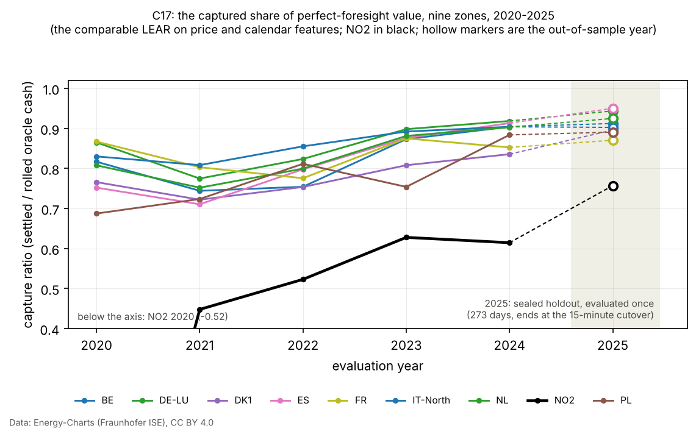
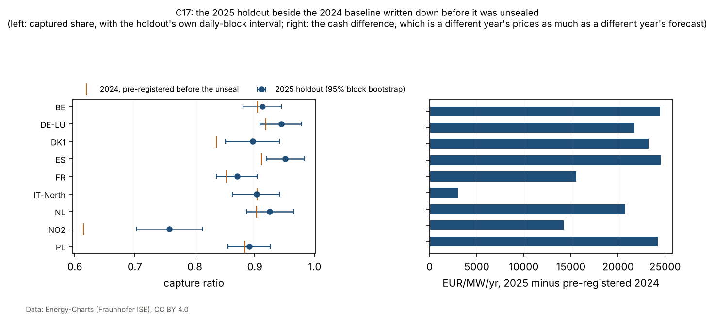

# eu-power-flexibility-value

**How much of a battery's theoretical arbitrage value in European day-ahead
power markets survives realistic forecast error?**

Nine European bidding zones, six evaluation years, one representative battery
dispatched against its own price forecast through a rolling-horizon LP on a
commit-then-settle basis — the forecast schedule is frozen and then valued at
*realised* prices, never at the prices it was optimised against.

**The out-of-sample answer: between 0.757 (NO2) and 0.950 (ES) of the
perfect-foresight value, costing 3,496 to 11,293 EUR/MW/yr against a battery
that knew the prices in advance.** Those are the 2025 holdout numbers: a
calendar year that was sealed for the whole build, evaluated exactly once, on
273 market days ending the day before the SDAC 15-minute go-live.

Full write-up of that evaluation: **`docs/holdout_2025.md`**.

## The finding

**The forecast got absolutely worse in the holdout year and economically
better.** Measured like for like against the previous year — every visible
year re-cut to January-September, because the holdout window stops at the
15-minute cutover — the pooled forecast error rose in all nine zones, and the
captured share of perfect-foresight value rose in seven of them anyway.

| against the previous year, like for like | direction | zones |
| --- | --- | --- |
| pooled MAE | **up** (worse) | nine of nine |
| mean realised daily spread | up | nine of nine |
| `error_over_headroom` (MAE / spread) | **down** (better) | nine of nine |
| within-day Spearman | up (better) | nine of nine |
| capture ratio | up | seven of nine |

The spread available to trade grew faster than the error did. That is the
project's one surviving cross-regime relationship, confirmed on a year the
model never saw: **what predicts how much value a battery captures is not the
forecast's error but the error relative to the headroom there is to trade** —
and, among point-forecast metrics, the within-day *ordering* of hours rather
than the level of the price. The holdout's capture is above every visible year
in six of nine zones on that like-for-like basis.

What it does **not** establish is in `docs/holdout_2025.md` §5, and the two
that matter most are stated here as well: the comparison against the previous
year is **unpaired**, because two years share no market day; and the
expanding training window means a holdout fold trains on more history than a
2024 fold did, so part of the improvement is training-set size rather than
anything about the year. Separating those needs a new, labelled experiment,
not a re-run.

## How it was built

- **Prices**: Energy-Charts (Fraunhofer ISE) day-ahead prices, nine zones,
  2019 onward, everything internally in UTC with local hour-of-day as an
  explicit feature and never as a resampling key.
- **Forecasts**: a naive same-hour-last-week floor, a LEAR (per-hour LASSO
  with in-fold scaling and selection), and one fixed LightGBM configuration
  with in-fold early stopping — no hyperparameter search across cycles, which
  in a build like this one is a leakage vector rather than a tuning step.
  Walk-forward, refit daily, expanding window.
- **Dispatch**: a one-megawatt, two-hour battery, symmetric round-trip efficiency,
  throughput cost, rolling horizon with end-of-day state of charge carried
  into the next day and a trailing-value terminal mark. Oracle, forecast and
  naive curves all dispatched through the same LP.
- **Leakage control**: executable assertions, written before the models —
  every feature's maximum timestamp checked against its row's gate closure on
  the train *and* test matrix of every fold, every training target checked as
  published before that fold's gate closure, plus shift, permutation and
  future-feature tripwires.
- **The holdout**: 2025 was sealed in code (`data/holdout.py`), the evaluation
  was pre-registered in full at Checkpoint C **before** the seal was broken
  (`backtest/results/c16_preregistration.json`), and the runner enforces that
  it happens once, whole, and in the registered environment. It ran once.

Results live in one append-only table, `backtest/results/results.csv`
(15,471 rows across seven runs). Long format: a new evaluation year is new
rows, never a new column. Every row carries its git SHA, config hash and
library fingerprint.

Design and cycle plan: `PLAN.md`. Pre-build audit: `docs/audit.md`. Running
build log, including every flag raised: `PROGRESS.md`. Method documents for
each layer: `docs/`.

## Honest limits

Day-ahead only — no intraday re-optimisation and no ancillary services, which
are a large part of a real battery's revenue stack. No per-zone grid fees,
levies or taxes. Price-taker throughout: the battery never moves the price it
trades against. Hourly resolution, with the main backtest ending at the
15-minute market cutover. The dispatch LP admits simultaneous charge and
discharge under sufficiently negative prices (FLAG C5-01; reviewed and kept as
a stated limitation, with the MILP variant measured). The ENTSO-E Art. 14
wind/solar forecast is published after gate closure, so it is reported only as
a measured leak premium and never used in an honest arm. No reservoir levels
for the hydro zones. `docs/holdout_2025.md` §5 and `PLAN.md` carry the full
list.

## Data sources, licence and attribution

The **code** in this repository is MIT licensed — see `LICENSE`. The **data**
is not the author's to license, and the derived artefacts in
`backtest/results/` and `docs/figures/` are derived works of two public
sources, each of which requires attribution:

- **Day-ahead prices, all nine bidding zones: Energy-Charts (Fraunhofer ISE),
  CC BY 4.0** — `api.energy-charts.info`. Licensed under
  [Creative Commons Attribution 4.0 International](https://creativecommons.org/licenses/by/4.0/).
  Every figure built on these prices carries the line
  `Data: Energy-Charts (Fraunhofer ISE), CC BY 4.0`.
- **Tier-A day-ahead load and wind/solar forecasts:
  ENTSO-E Transparency Platform** — `transparency.entsoe.eu`, used under the
  platform's reuse conditions, which require attribution. Figures built on
  these series name the platform and the article the series comes from
  (Art. 6 load, Art. 14 wind/solar).

Neither source endorses this work. No raw data from either source is
committed: `data/raw/` is gitignored and what is committed is the fetch code
plus the manifest in `data/manifest/`, which records row counts and payload
fingerprints so a reader can re-pull the same data and check they got the same
bytes. The attribution strings are declared once, in `config/data.yaml`, and
the C20 gate checks that every committed figure's producing module emits them.

## Build process disclosure

This repository was built by an autonomous coding agent (Claude) running in
scheduled unattended cycles, under a written plan with executable leakage
tests, a sealed holdout, and mandatory human checkpoints before any result was
finalized. That process — the plan, the guardrails, and the bugs they caught —
is treated as part of the deliverable rather than something to hide, and
`PROGRESS.md` is the unedited log, flags included.

Two things that process did not deliver as designed, stated here rather than
only in the log. It is public (since 2026-10-29), at the owner's instruction,
before the checkpoint that was meant to decide it; the pre-public
review gate therefore ran afterwards rather than before, and what it found is
in `docs/c20_pre_public_gate.md` (no secret in any of the 181 commits, no raw
data ever committed, an independent clone reproducing the published numbers —
and two attribution breaches in this file and in three figures, since fixed).
And the holdout evaluation ran on a CPython patch release one version newer
than the pre-registered one, because the pinned interpreter cannot be built in
the container these cycles run in; the owner approved that single deviation
explicitly, the five numerical libraries were at their exact pinned versions,
and the 2025 rows carry the deviating fingerprint so a reader can tell
(`docs/c17_environment.md`, `backtest/results/c17_environment_approval.json`).
