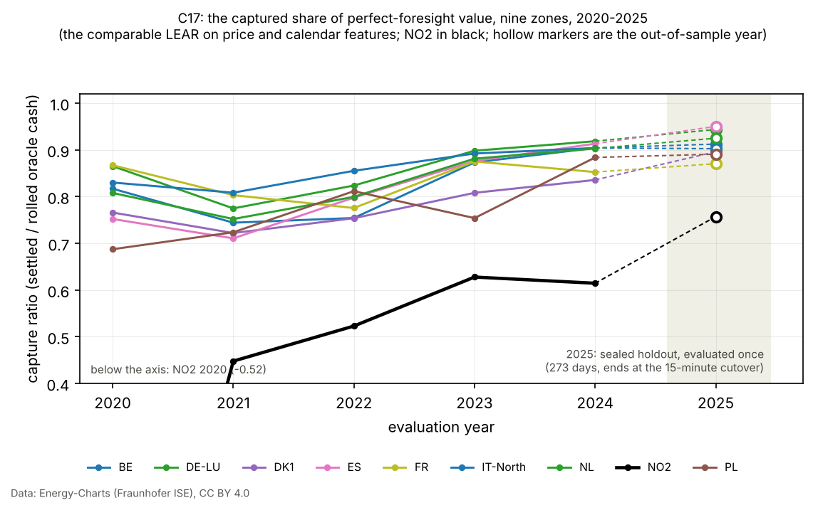
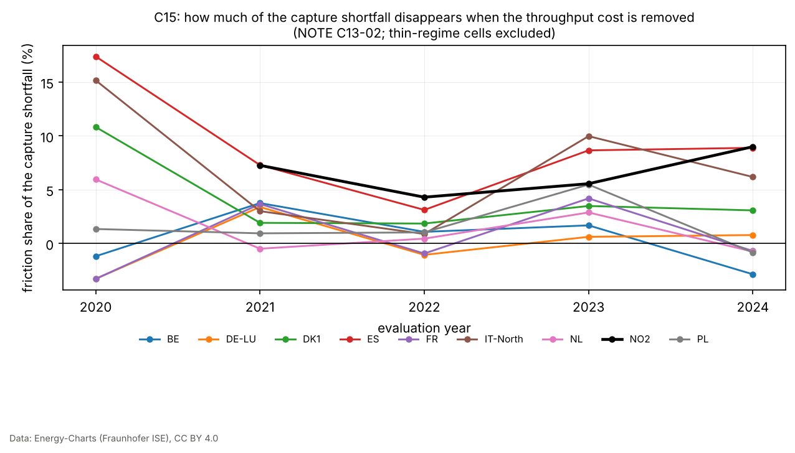
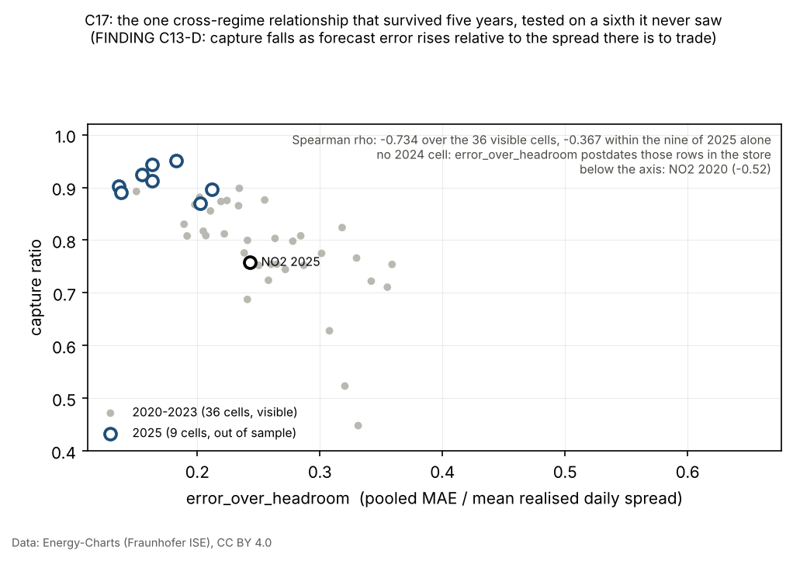

# How much of a battery's day-ahead arbitrage value survives forecast error?

**Nine European bidding zones, 2020–2025, one representative battery, one
pre-registered out-of-sample year.**

*Draft (C18). Every number is bound to a committed artefact in
`backtest/results/`; `tests/test_c18_writeup.py` re-derives the headline ones
from those artefacts rather than trusting this text. Awaiting Checkpoint D
review (PLAN.md C19). Length: ~5 200 words including five tables —
§§1–5 and 7 run to roughly seven rendered pages against PLAN.md's four-to-six,
plus §6's desk page. What remains is either a result or a label an earlier cycle
made mandatory, so where to cut further is a judgement call for the reviewer:
NOTE C18-01 in `PROGRESS.md` puts the three candidates.*

---

## 1. Executive summary

A battery's day-ahead arbitrage value is usually quoted with hindsight: solve the
day's realised price curve and read off the spread. That number is not tradeable.
A real battery commits a schedule at gate closure on the strength of a
**forecast** and then lives with the prices that arrive. This project measures
the gap, across nine zones with genuinely different price formation.

The method is plain; the discipline is where the work is. A price forecast per
zone (naive floor, LEAR, one frozen LightGBM config), walk-forward and refit
daily on an expanding window. A rolling-horizon LP dispatching a 1 MW / 2 h
battery against that forecast, which **freezes the schedule and then values it
at realised prices** — "commit-then-settle": the LP's own objective from the
forecast run is never reported as value. And a sealed calendar year,
pre-registered in full before the seal was broken, then evaluated once.

**Out of sample, the forecast-driven battery captured 0.757 (NO2) to 0.950 (ES)
of the perfect-foresight value, giving up 3 496 to 11 293 EUR/MW/yr to forecast
error.** Those are the 2025 holdout numbers over 273 market days to
2025-09-30, the day before the SDAC 15-minute go-live. `naive ≤ forecast ≤
oracle` held in all nine zones, and the per-day oracle bound held on every day.

Four results a desk might use:

1. **Most of the theoretical value is capturable, and the residual is not
   friction.** Eight of nine zones sit at 0.87–0.95. Removing *every* euro of
   round-trip and throughput cost closes only **~3%** of the capture shortfall.
   Friction costs the battery money — +1 982 EUR/MW/yr of prize at zero
   throughput cost — but "friction costs money" and "friction explains the
   shortfall" are different claims and only the first is true.
2. **Forecast error is the wrong thing to steer by; error relative to the
   headroom is the right one.** Over 44 (zone, year) cells, pooled MAE's rank
   correlation with capture is **−0.015**. For `error_over_headroom` (MAE ÷
   mean realised daily spread) it is **−0.738**, and for the within-day
   Spearman correlation of the hourly ordering **+0.698**. Rank candidate
   models on the within-day ordering and translate the winner into EUR/MW/yr
   with the capture ratio; never rank two models on capture measured in one
   year, which decides 1 of 15 contrasts.
3. **The asset spec dominates the market friction.** By mean effect on realised
   cash: 2 h → 4 h duration **+25 094 EUR/MW/yr**; the end-of-day
   state-of-charge convention **−3 185** (forced daily reset) to **+2 943** (no
   closing mark); throughput cost **±2 000–2 800** over 0/2/5 EUR/MWh. The
   duration decision is worth more than everything else in the ladder together.
4. **One zone behaves differently, and not because of spread.** NO2
   (hydro-dominated) is last of nine on capture *and* on within-day ordering in
   all six years. Conditioning on spread removes almost none of the deficit;
   removing all friction closes 6–12% of it. The surviving candidate is that
   the forecast puts NO2's **hours in the wrong order** — and in NO2 the
   within-day residual-load swing has no measurable relationship to the price
   spread (ρ ≈ +0.01 to +0.04), so the information a model needs is not in its
   inputs.

**The surprising finding (§4): in the holdout year the forecast got absolutely
worse in all nine zones and economically better in seven**, because the spread
available to trade grew faster than the error did.

Two limits belong on the front page. A capture band measured in one year is
**not** a regime effect — a zone moves across years by as much as the zones
differ within a year — so the cross-regime divergence here is *a finding about
NO2 plus a direction*. And the honest ENTSO-E exogenous block (load and RES
forecasts as a bidder could legitimately have had them) **has no reliable
positive value in any zone, year or model class**. §5 has the rest.

---

## 2. Method

**Data.** Day-ahead prices for nine zones from **Energy-Charts** (Fraunhofer
ISE, CC BY 4.0), 2019 onward. *Tier A*: DE-LU (thermal/RES-mixed), ES
(solar-dominated), NO2 (hydro-dominated). *Tier B*: FR, NL, BE, IT-North, DK1,
PL. Tier-A exogenous features — day-ahead load forecast (Art. 6) and wind/solar
forecast (Art. 14) — come from the **ENTSO-E Transparency Platform** from 2022,
the first year archived D-1 vintages exist. Everything is held internally in
**UTC**; local hour-of-day is an explicit feature, never a resampling key; rows
per (zone, day) are asserted against a DST whitelist rather than filled. No raw
data is committed — `data/manifest/` carries row counts and payload
fingerprints, re-verified against fresh pulls by later cycles. Open-Meteo
reanalysis was rejected as an input (actuals dressed as weather history), as was
AGSI+ storage as a gas-price proxy.

**Forecasts.** *Naive*: same delivery hour one week back — the rMAE denominator,
and a hard reference for a weekly-cyclical product. *LEAR*: the open-benchmark
regularised linear model — one LASSO per delivery hour on variance-stabilised
prices, with scaling, one-hot levels and the penalty all estimated **in-fold**
and applied frozen, on price lags (24/48/72/168 h), lagged daily mean/min/max and
calendar columns. *GBM*: one **fixed** LightGBM configuration with in-fold early
stopping, pinned to literals by a test, because PLAN.md forbids hyperparameter
search across cycles — tuning against repeatedly visible metrics is a leakage
vector, so moving a knob requires editing a test, which is a flag-and-stop
event. All arms walk forward, refit daily, expanding window from 2019.

**Leakage control, written before the models**, as executable assertions run
every cycle: every feature's maximum timestamp checked against its row's gate
closure on the **train and test** matrix of every fold; every training target
checked as published before that fold's gate closure; shifting the features
forward one day must *degrade* metrics; a future-timestamped feature must be
*caught*; permuting the target must *destroy* skill.

**Battery and dispatch.** 1 MW, 2 h, round-trip efficiency 0.88 split √0.88 per
leg, throughput cost 2 EUR/MWh delivered, opening SoC 50%. The horizon is one
market day, rolling; **realised end-of-day SoC carries into the next day**; and
closing inventory is *valued* against a 7-day trailing realised price quantile —
identical across the oracle, forecast and naive curves and knowable at gate
closure, because with no terminal condition a 24-hour LP always empties the
battery before midnight and silently turns rolling carryover into the daily
reset PLAN.md forbids. Two invariants are asserted every cycle:
`value(forecast @ realised) ≤ value(oracle @ realised)` on **every** day, and
`value(naive @ realised) ≤ value(forecast @ realised)` **on average** (per-day
violations are expected). The headline ratio is settled cash over the *rolled*
perfect-foresight run's cash on the same days, so one denominator per zone makes
the curves comparable. Intervals throughout are a paired circular moving-block
day bootstrap, 10 000 replicates, seed 20261009, with a 1/7/14-day block ladder
as a robustness check — read the rung least favourable to the claim.

**The holdout.** 2025 was sealed in code for the whole build: loading, reading,
feature-engineering or measuring against it raised. The single evaluation was
**pre-registered in full at Checkpoint C before the seal was broken** — window,
zones, curves, model specs, walk-forward config, battery, metrics, bootstrap and
the 2024 baseline it would be read against — and the preflight checked all
fifteen frozen specifications field by field: zero disagreements. The runner
enforces by itself that the evaluation happens **once** (committed ledger, no
override flag), **whole** (it refuses to narrow the nine zones), **in the
registered environment**, and with **nothing 15-minute in any number**. It ran
once, on 2026-11-23, 10:17:59Z–11:23:13Z; one condition was approved as a
labelled deviation rather than waived (§5, *On the build*).

---

## 3. Results

### 3.1 The holdout year

LEAR on price and calendar features only, dispatched commit-then-settle. 273
market days, 2025-01-01 to 2025-09-30.

| zone | capture | 95% interval | EUR/MW/yr | lost vs oracle | MAE | rMAE | within-day Spearman |
| --- | --- | --- | --- | --- | --- | --- | --- |
| ES | 0.9504 | [0.9196, 0.9821] | 66 931 | 3 496 | 18.70 | 0.665 | 0.8962 |
| DE-LU | 0.9439 | [0.9089, 0.9778] | 89 910 | 5 348 | 22.37 | 0.695 | 0.8737 |
| NL | 0.9251 | [0.8864, 0.9644] | 89 414 | 7 240 | 21.29 | 0.701 | 0.8750 |
| BE | 0.9125 | [0.8803, 0.9446] | 80 514 | 7 718 | 20.36 | 0.673 | 0.8652 |
| IT-North | 0.9026 | [0.8626, 0.9412] | 40 793 | 4 400 | 9.82 | 0.672 | 0.8960 |
| DK1 | 0.8962 | [0.8514, 0.9410] | 77 148 | 8 940 | 26.64 | 0.706 | 0.7928 |
| PL | 0.8909 | [0.8555, 0.9255] | 92 224 | 11 293 | 21.65 | 0.725 | 0.8380 |
| FR | 0.8706 | [0.8362, 0.9036] | 62 358 | 9 269 | 19.43 | 0.620 | 0.8609 |
| NO2 | 0.7572 | [0.7035, 0.8127] | 30 219 | 9 689 | 15.66 | 0.631 | 0.7202 |

The naive floor captures 0.5726 (NO2) to 0.9083 (ES) on the same days, so the
LEAR's contribution over "copy last week" runs from +4.2pp (ES) to +18.5pp (NO2)
of perfect-foresight value. The holdout's invariant flag file is empty.

### 3.2 Six years, nine zones

Capture ratio by zone and year — 2020–2024 visible (full calendar years), 2025
the holdout (273 days):

| zone | 2020 | 2021 | 2022 | 2023 | 2024 | **2025** |
| --- | --- | --- | --- | --- | --- | --- |
| DE-LU | 0.8652 | 0.7749 | 0.8238 | 0.8983 | 0.9187 | **0.9439** |
| ES | 0.7522 | 0.7107 | 0.7980 | 0.8762 | 0.9109 | **0.9504** |
| NL | 0.8080 | 0.7521 | 0.7996 | 0.8814 | 0.9031 | **0.9251** |
| BE | 0.8170 | 0.7443 | 0.7544 | 0.8733 | 0.9044 | **0.9125** |
| IT-North | 0.8302 | 0.8085 | 0.8553 | 0.8923 | 0.9042 | **0.9026** |
| DK1 | 0.7660 | 0.7221 | 0.7539 | 0.8082 | 0.8358 | **0.8962** |
| PL | 0.6875 | 0.7238 | 0.8118 | 0.7541 | 0.8839 | **0.8909** |
| FR | 0.8672 | 0.8032 | 0.7757 | 0.8752 | 0.8526 | **0.8706** |
| NO2 | −0.5222 | 0.4480 | 0.5230 | 0.6279 | 0.6146 | **0.7572** |

**A one-year capture band is not a regime effect.** Within a zone, capture moves
across years by 9.6–20.0pp (the eight non-outlier zones) against a single year's
bootstrap sd of 2.8–5.1pp; the eight-zone band *within* a year is 8.3–18.0pp —
the same size. That eight-zone band is **not established**: a noise-only null
band clears 5% in exactly **one of five** visible years (the nine-zone band
clears in four of five), so the cross-regime divergence is **a finding about NO2
plus a direction**. Relatedly, **2024 was the most favourable of the five
visible years** — highest capture in six of nine zones — so every 2024 headline
in `docs/` travels with that clause.

**The 2022 crisis multiplied the prize and the loss and left the captured share
alone.** Oracle value ×1.72–2.71 against 2021, EUR/MW/yr lost to forecast error
×2.4–4.2, capture *ratio* −8.04 to +4.95pp with **one of nine** intervals
excluding zero. More money made, more money lost, roughly the same fraction
captured. (Year-on-year intervals are unpaired: two years share no market day.)
NO2 2020 sits outside the band and is a regime fact, not a bug — FLAG C13-01.

### 3.3 Which forecast, and what ranks them

2024 validation year, Tier A, honest arms (nine-curve common hours, so the day
set differs slightly from §3.2):

| zone | | naive | LEAR price-only | LEAR full-history | GBM price-only |
| --- | --- | --- | --- | --- | --- |
| DE-LU | capture | 0.8471 | 0.9101 | 0.9187 | 0.9042 |
| | MAE | 32.73 | 23.55 | 22.89 | 22.80 |
| | Spearman | 0.7596 | 0.7946 | 0.8109 | 0.8078 |
| ES | capture | 0.8340 | 0.9160 | 0.9133 | 0.8938 |
| | MAE | 26.94 | 18.10 | 17.45 | 18.31 |
| | Spearman | 0.8306 | 0.8478 | 0.8361 | 0.8514 |
| NO2 | capture | 0.4844 | 0.6278 | 0.6146 | 0.6076 |
| | MAE | 21.20 | 14.76 | 13.66 | 14.06 |
| | Spearman | 0.5490 | 0.5526 | 0.5781 | 0.6081 |

Everything beats naive by a wide margin on both scales; after that the ranking
is mostly noise, and three labels are required before quoting any model
comparison from this project.

**MAE does not visibly predict capture — "undetermined", not "contradicted".**
One validation year decides **1 of 15** honest capture contrasts (median |Δ| ÷
bootstrap sd = 0.46), against 7 of 15 for MAE and **8 of 15 for the within-day
Spearman**. Capture is ~4× noisier per unit of effect, so one year can neither
establish nor rule out the relationship.

**So rank arms on the within-day Spearman and translate to EUR/MW/yr with
capture.** Across the nine zones the Spearman's rank correlation with capture is
**+0.70 [+0.35, +0.93]** and survives dropping NO2 (+0.57 [+0.07, +0.91]); rMAE
manages +0.60 [−0.08, +0.85] with the **wrong sign**, MAE +0.05 [−0.25, +0.50].

**Relative skill is indistinguishable from constant across the nine zones**:
rMAE's band cannot be told apart from nine draws of one number (noise-only
p = 0.20–0.37), while capture's band is 4.2–6.1× its own sampling noise. The
same machinery is about equally good everywhere; what it is *worth* is not.

**Three extra years of price history beat the entire honest exogenous block and
the switch to a booster in all three Tier-A zones — on MAE** (+2.80 / +3.53 /
+7.45%); on capture that contrast is +0.86 / −0.27 / −1.31pp, none of it
surviving a CI, so it is an **MAE claim** and labelled as one. The one
established between-class contrast runs the "wrong" way: in ES the booster
captures **2.22pp less** than the LASSO ([−4.25, −0.29]) in the zone where it
also has the lower MAE.

**The exogenous block buys nothing honest, and measures a leak precisely.**
Across the six booster cells of `res_persistence − price_only`, **exactly one
excludes zero and it is negative** (DE-LU 2023, −3.55pp [−6.76, −0.33]); under
the LASSO all six contain zero, and on MAE the twelve cells sit inside ±4% with
the sign flipping between years in four of six (zone, model) pairs. **This
write-up therefore makes no exogenous gain claim.** What the block does measure
cleanly is the value of a **publication timestamp**: the as-published Art. 14
vintage is worth +8.4% of MAE on DE-LU and +11.3% on ES under the LASSO, and
**+23.96% / +17.82% under the tree ensemble** on identical rows, vintages and
folds. The leak is worth more to a non-linear model, and the booster's whole
advantage over the LASSO sits in the leaky arm — so "gradient boosting beats
LEAR on a RES-fed day-ahead model" is substantially an artefact of when a file
was published.

### 3.4 Fundamentals: where "price follows residual load" is true

Price against residual load (load − wind − solar), Tier A, 2022–2024: strong in
**DE-LU and ES** (R² 0.56–0.80), weak in **NO2** (0.32–0.36), where in 2022 the
fitted supply curve runs *backwards*. **A cross-zone fundamentals claim has
to carry the zone**, and a crisis year degrades every fundamental relationship
measured here.

This supplies the mechanism behind §1's point 2 and splits it in two:
**RES build-out creates the headroom** (between-cell, relative within-day RES
swing against `error_over_headroom`, ρ ≈ −0.72) and **RES forecast error eats
into it** (within-cell, day-over-day revision of as-published residual load
against `error_over_headroom`, ρ ≈ +0.50 DE-LU, +0.35 ES, 2–3× weaker in NO2).
The first is structural — the market handing the battery a wider spread; only
the second is something a better model fixes. The predictor is a *revision*, a
lower bound on the error a bidder carried, and is labelled as such on every row.

In NO2 the realised daily spread has **no measurable relationship** to the
within-day residual-load swing in any of the three years (+0.012 / +0.035 /
+0.020) — which is why NO2's low capture survives every explanation tried.

### 3.5 Sensitivities: the asset spec dominates the market friction

Six batteries × 51 (leg, zone, year) cells = 1 836 rolling-horizon runs, nothing
re-fitted. Reported in **EUR/MW/yr**, because that is the scale on which these
levers are decided: four of five are decided in 42–44 of 45 cells on cash, where
the best manages 11 of 45 on capture points.

| lever | mean Δ realised cash (EUR/MW/yr) | mean Δ capture (pp) |
| --- | --- | --- |
| duration 2 h → 4 h | **+25 094** | +1.61 |
| SoC: forced daily reset | **−3 185** | −3.97 |
| SoC: no closing mark | +2 943 | +1.28 |
| throughput cost 2 → 0 EUR/MWh | +1 982 | +2.18 |
| throughput cost 2 → 5 EUR/MWh | −2 799 | −2.90 |

**The duration decision is worth more than everything else in the ladder put
together**: the 4 h battery earns +25 094 EUR/MW/yr and +1.61pp of capture while
doing 95 *fewer* full cycles a year. And on §3.1's missing 5–24%: at zero
throughput cost **~3% of the capture shortfall closes and ~97% does not**. The
gap between a forecast battery and a clairvoyant one is forecast error.

---

## 4. The surprising finding

**In the holdout year the forecast got absolutely worse in all nine zones and
economically better in seven.**

Capture came out above every visible year in seven of nine zones, which is the
kind of result that is usually a bug, so the obvious confound was removed first.
The holdout window is 273 days ending 2025-09-30 while the visible years are
full calendar years — so every visible year was re-aggregated over
**January–September only**, from the same committed per-day rows, by the same
definitions, nothing re-fitted. On that like-for-like basis the holdout is above
every visible year in **six** of nine zones and inside the visible range in the
other three (FR, IT-North, PL). The Q4 term is real but small and two-sided:
over 44 visible cells, including October–December moves a zone-year's capture by
a median of **−1.04pp** (range −7.95 to +8.34). So the short window is mildly
favourable and the correction it justifies is about one percentage point —
against year-on-year changes of −0.6pp (PL) to +11.7pp (NO2).

Against 2024, like for like:

| | direction | zones |
| --- | --- | --- |
| pooled MAE | **up** (worse) | 9 of 9 |
| mean realised daily spread | up | 9 of 9 |
| `error_over_headroom` (MAE ÷ spread) | **down** (better) | 9 of 9 |
| within-day Spearman | up (better) | 9 of 9 |
| capture ratio | up | 7 of 9 |

DK1's pooled MAE rose from 21.15 to 26.64 EUR/MWh and its capture rose 3.3pp.
NO2's rose from 11.33 to 15.66 and its capture rose **11.7pp**. The spread
available to trade rose faster than the error did, in every zone. 2025 has the
lowest `error_over_headroom` of any year in all nine zones, and the within-day
Spearman rose in all nine — most of all in NO2 (0.6106 → 0.7202), the zone
whose capture rose most.

This is the project's one surviving cross-regime relationship, confirmed on a
year the model never saw, and a direct out-of-sample refutation of the intuition
that a lower MAE means more captured value: the two moved in opposite directions
in nine zones out of nine.

The practical reading is a warning about model selection. A desk that picks its
day-ahead model, sizes its battery, or reports its forecasting programme's
progress on MAE is steering by a quantity that moved the **wrong way** in the
one year this project held out, while the quantity that pays improved.

**What it is not.** It is not evidence that worse forecasting is fine: MAE rose
because the market got more volatile, and a model whose error had held flat
while the spread widened would have captured more still. The claim is about
which metric to steer by — and it is one year (§5, first two bullets).

---

## 5. Limits — what this does not establish

**On the holdout comparison.**

- **One year, and the comparison against 2024 is unpaired.** Two years share no
  market day, so §3.1's intervals are the holdout's own sampling uncertainty,
  not the uncertainty of the *difference*. Three of nine zones' 2025 intervals
  exclude the pre-registered 2024 point (DK1, ES, NO2); six do not. Read "2025
  is better" as directional.
- **The expanding window confounds the year.** A 2025 fold trains on 2019–2024,
  a 2024 fold on 2019–2023, and three extra years of price history were worth
  more than the entire honest exogenous block on MAE — so part of the
  improvement is almost certainly training-set size. Separating the two needs a
  **new** experiment with the training window held fixed, not a re-run, and must
  be labelled as one.
- **The nine-zone capture band is not a regime effect** (§3.2): the holdout's
  19.3pp band is one more year's draw. And **no exogenous arm was evaluated on
  the holdout** — the pre-registered headline is price-only.

**On the modelling.**

- **The Art. 14 RES-forecast vintage caveat.** The archived day-ahead wind/solar
  forecast is published *after* gate closure and revised intraday, so it is not
  what a bidder had. It appears only as §3.3's labelled leak measurement; the
  honest stand-in buys nothing.
- **One fixed GBM configuration, deliberately untuned**: a tuned booster might
  do better, and this project cannot say, because tuning against repeatedly
  visible metrics is the leak the design forbids. **No public-holiday calendar**
  either — declared and deferred for want of a sourced per-zone calendar.
- **In NO2, 18 784 hours of the 2025 Art. 14 wind forecast are NaN after hourly
  aggregation**, because ENTSO-E moved to a 15-minute MTU during 2025 and the
  aggregator refuses to average a UTC hour its sub-hourly intervals do not tile
  exactly. A refusal to partially average, not a hole; it costs nothing in the
  price-only headline.

**On the dispatch model.**

- **Day-ahead only** — no intraday re-optimisation and no ancillary services,
  together a large part of a real battery's revenue stack. **Price-taker**
  throughout: fine at 1 MW, bad at 100 MW in a thin zone. **No per-zone grid
  fees, levies or taxes**, which differ materially here and would move the
  *ranking*, not just the level.
- **Hourly resolution**, with the main backtest ending the day before the
  15-minute go-live. Native 15-minute analysis is a labelled stretch goal and
  was not attempted; a 15-minute market plausibly widens the reachable spread,
  so these are a conservative read of a post-2025 asset.
- **The LP admits simultaneous charge and discharge under sufficiently negative
  prices** (FLAG C5-01) — an LP artefact, reviewed at Checkpoint B and kept as a
  stated limitation with the MILP variant measured. Small and conservative: at
  worst 9 of 365 days (FR 2024), 2.70 MWh burned over a year, 0.14% of settled
  cash, biasing capture *against* the model. In the holdout, on the oracle
  curve: 21 days DE-LU, 19 NL, 17 BE, 16 PL, 11 FR, 6 DK1, none in ES, IT-North
  or NO2.
- **The end-of-day inventory mark may be costing the battery money** — the
  honest surprise of the sensitivity ladder. The committed battery already ends
  **74–77% of days empty**, so the closing mark mostly fails to prevent the
  nightly degeneration it exists for, and where it binds the point estimate says
  it *costs* ~2 900 EUR/MW/yr. **Not established** (16 of 45 cells on cash, 0 of
  45 on capture); nothing was changed on the strength of it and the decision is
  open for human review (NOTE C15-01).
- **No reservoir levels, inflow or snowpack for the hydro zones** — a real
  omission for NO2 specifically, the one zone whose behaviour this project
  cannot explain.

**On the data and the zones.**

- **Structural breaks inside the window, flagged not modelled through**: the
  **Iberian exception** gas price cap (ES, 2022-06 to 2023-12); **IT-North**'s
  zonal reconfiguration (2021-01-01); **PL**'s move to SDAC implicit allocation
  (2021-06); and the **15-minute cutover** (2025-10-01) at the end. DE-LU's
  2018-10 split from DE-AT-LU predates the window.
- **Two recorded failures of the pooled naive-dominance invariant**, neither
  "fixed" by relaxing a check. **FLAG C13-01, NO2 2020**: the comparable arm
  settles −402 EUR/MW against the naive floor's +253 in a market where the
  *perfect-foresight* battery earns 769 EUR/MW/yr and the mean daily spread is
  3.41 EUR/MWh against a 2 EUR/MWh throughput cost — with no headroom, which
  curve trades less is luck. The cell is excluded from band statistics under a
  declared floor; the assertion still reports `holds: false` and exits non-zero.
  **FLAG C14-01, DE-LU 2023, one leaky GBM arm**: −87 EUR over 364 days, 0.16%,
  95% interval [−6.22, +6.15]pp — a **tie in a deep market**, and the sharpest
  instance of §3.3's point, since that arm has the second-best honest MAE of
  eight DE-LU curves (23.60 against naive's 33.62) and the **worst** capture
  (0.8453 against naive's 0.8467).

**On the build.**

- Built by an autonomous coding agent in scheduled unattended cycles, under a
  written plan with executable leakage tests, a sealed holdout and human
  checkpoints. `PROGRESS.md` is the unedited log, flags included.
- **The holdout ran on a CPython patch release one version newer than the
  pre-registered one**, because the pinned interpreter cannot be built in the
  container these cycles run in. The owner approved that single deviation
  explicitly, the five numerical libraries were at their exact pinned versions,
  and the 2025 rows carry the deviating library fingerprint so a reader can
  tell; an independent clone under a *third* library set reproduced the published
  per-day dispatch numbers to 4.3e-07 EUR.
- **The repository went public before the checkpoint meant to decide it** (FLAG
  C-E-01, at the owner's instruction), so the pre-public gate ran afterwards: no
  secret in any commit, no raw data ever committed, an independent clone
  reproducing the published numbers, and two attribution breaches since fixed.
- **Four tests are currently red and all four are correctly obsolete** (FLAG
  C17-05): they assert a pre-evaluation world that the approved evaluation
  legitimately ended. Nothing under `tests/` was edited to make them green — a
  green suite obtained that way would mean a tripwire had been deleted.

---

## 6. What a desk would additionally need

This is a research backtest of one revenue line for one asset under a
price-taker assumption. Taking it to a trading or investment decision needs the
following, none of it in scope here.

**Revenue stack.** Day-ahead arbitrage is a minority of a European battery's
revenue. A full case needs **intraday** (continuous and auctions — where the
optionality is worth most, and where re-optimising against the day-ahead
commitment changes the problem), **balancing and ancillary services**
(FCR/aFRR/mFRR capacity and energy, with prequalification, availability
obligations and penalty regimes), **capacity or flexibility payments** where they
exist, and the **stacking rules** deciding which can be held simultaneously on
the same MW. Stacking is a constraint problem, not an addition problem.

**Curve construction and marking.** This project marks closing inventory against
a 7-day trailing realised quantile because it needed something knowable,
identical across curves and not a leak. A desk marks against a **forward
curve** — built, interpolated and seasonally shaped across delivery periods, with
the basis between hourly/block products and the underlying, and an explicit view
on the spread term. P&L attribution between curve moves and dispatch decisions
follows from that choice, and so does hedging.

**Risk framework and limits.** Position limits per zone and delivery period;
VaR/ES on the spread position with a defensible cross-zone correlation
structure; stress scenarios (a 2022 repeat, a negative-price cluster, a
cutover-like design change); liquidity limits recognising that these nine zones
are not equally tradeable; and the **price-impact** model this project
explicitly lacks — a 100 MW book in NO2 is not nine times the same trade.

**Credit, collateral and clearing.** Exchange membership and clearing-house
initial and variation margin; intraday margin calls in a volatile week;
bilateral credit lines and CSAs for OTC hedges; the funding cost of collateral,
a real drag on a spread book; and counterparty concentration.

**Regulatory and compliance.** **REMIT** — inside-information disclosure for a
storage asset, market-manipulation rules on withholding and cross-market
strategies, and transaction reporting. **MAR** exposure where a listed parent is
involved; **EMIR** reporting for derivative hedges; the **MiFID II**
ancillary-activity analysis for the trading entity; grid-connection and
licensing terms; metering and settlement; and TSO prequalification if ancillary
revenue is in the plan.

**Asset and operational reality.** Degradation as a warranted, enforceable curve
rather than a flat 2 EUR/MWh — cycle and calendar aging, depth-of-discharge
dependence, temperature, warranty throughput caps, and the augmentation capex
those imply. Availability and outage assumptions; auxiliary load; a round-trip
efficiency that decays over life; grid fees, levies, taxes and loss factors per
zone; and the nomination and gate-closure timetable, including what happens when
the schedule cannot be delivered and the imbalance exposure that creates.

**Model operations.** Forecast delivery before gate closure every day, with
monitoring and a fallback when the model or its inputs fail; retraining cadence
and the drift monitoring that triggers it; input-vintage discipline in
production — §3.3's Art. 14 problem is a *production* trap as much as a
backtesting one, since a live system reading the current file gets a leak it
cannot trade; and model governance with independent validation and an audit
trail.

**What this project would do next, in priority order.** (1) Hold the training
window fixed and re-run 2025, to separate the window effect from the year
effect. (2) Dispatch against the native 15-minute market after the cutover — a
wider reachable spread is exactly what §4 says pays. (3) Add intraday
re-optimisation, the largest missing revenue line and the one that interacts
most with commit-then-settle. (4) Get reservoir and inflow data for NO2 and test
whether the one zone this project cannot explain becomes explicable with the
fundamental its price formation actually runs on.

---

## 7. Provenance

**Code** is MIT (`LICENSE`); the **data** is not the author's to license.
Day-ahead prices for all nine zones are **Energy-Charts (Fraunhofer ISE),
CC BY 4.0**; Tier-A load and wind/solar forecasts come from the **ENTSO-E
Transparency Platform** under its reuse conditions. Neither source endorses this
work. Every committed figure carries its attribution and a gate checks that it
does.

Results live in one append-only long-format table,
`backtest/results/results.csv` (15 471 rows across seven runs): a new evaluation
year is new rows, never a new column, and every row carries its git SHA, config
hash, model fingerprint and library fingerprint.

Method documents, one per layer, are in `docs/` — including
**`holdout_2025.md`**, the pre-registered holdout write-up, whose §5 this
document's §5 carries forward. Design and cycle plan: `PLAN.md`. Pre-build
audit: `docs/audit.md`. Unedited build log, flags included: `PROGRESS.md`.
